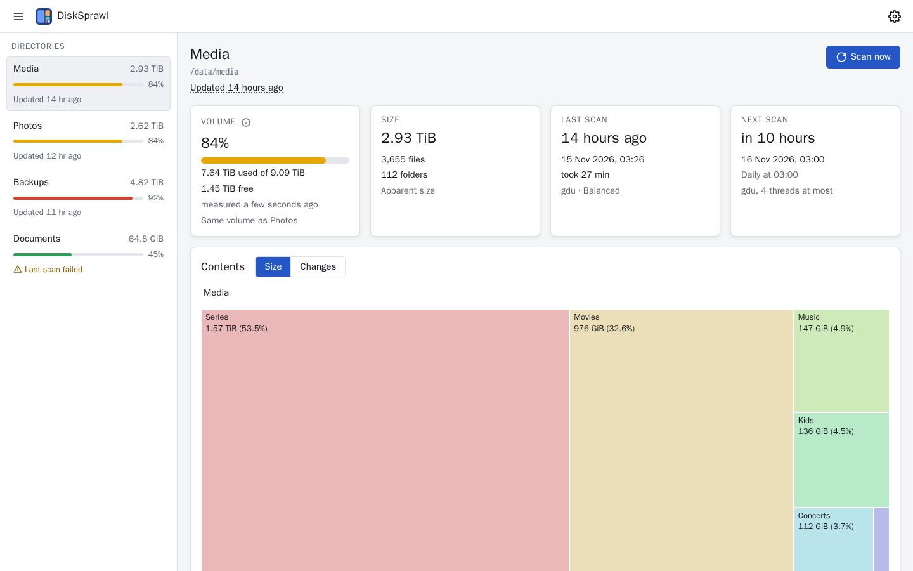
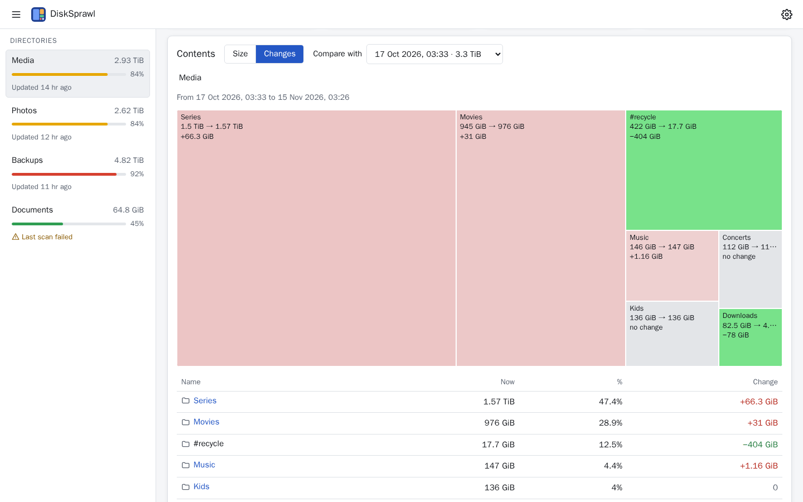
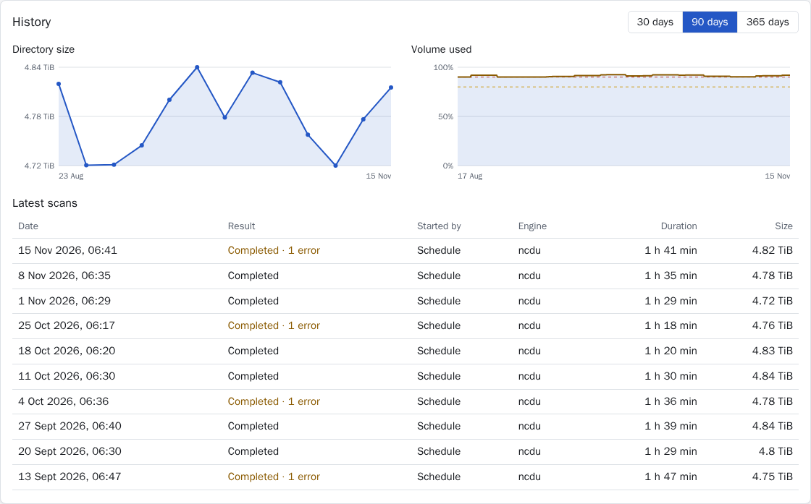
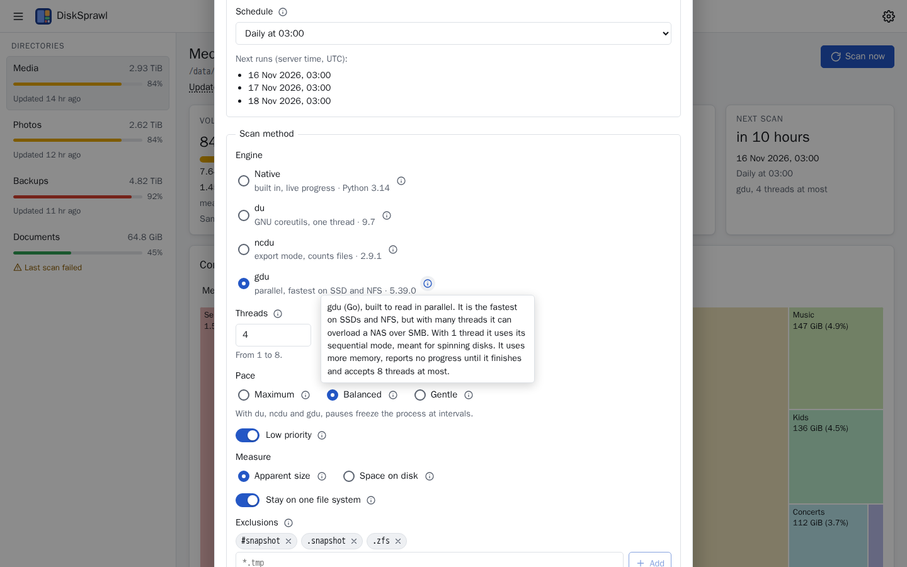
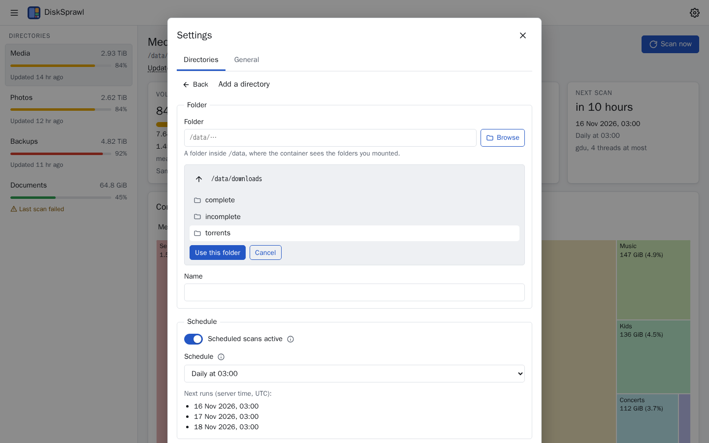
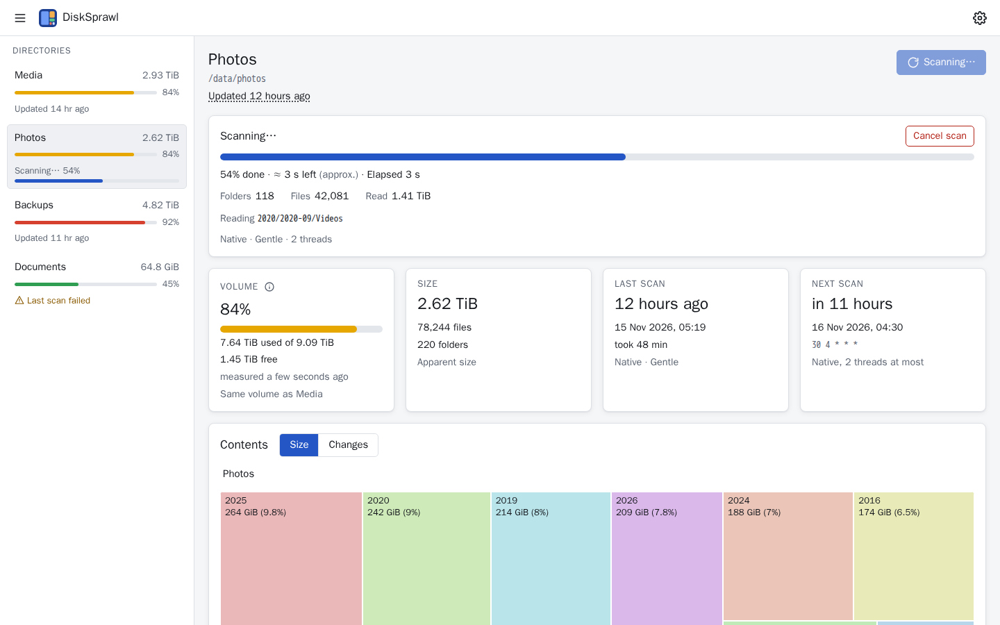
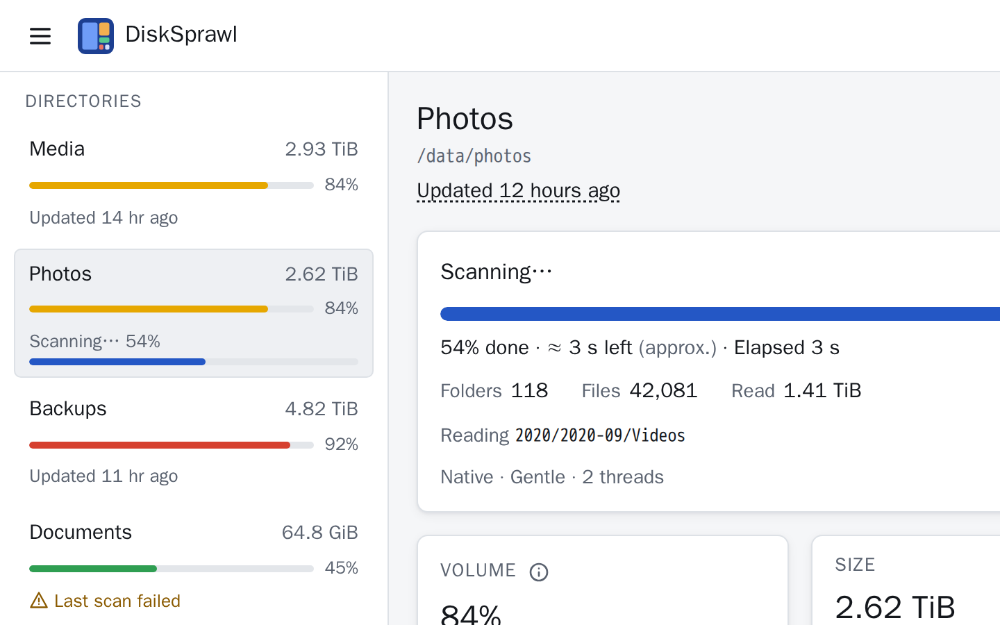
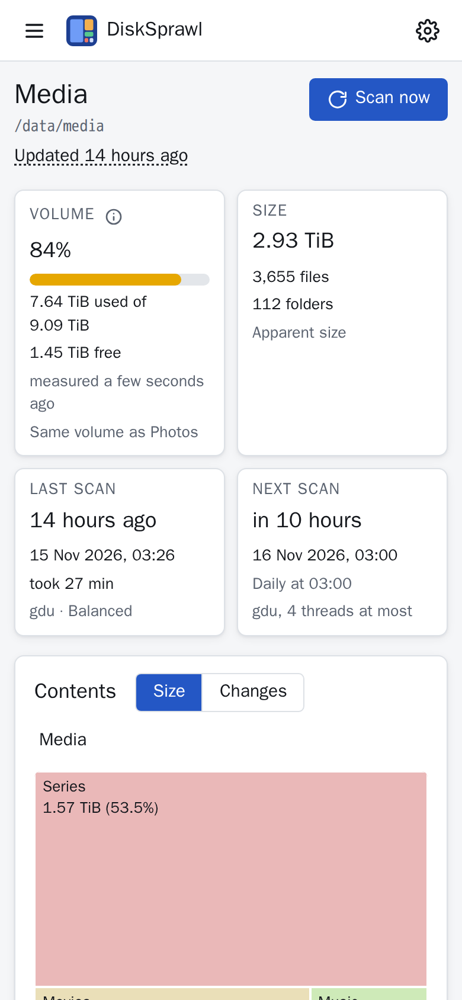
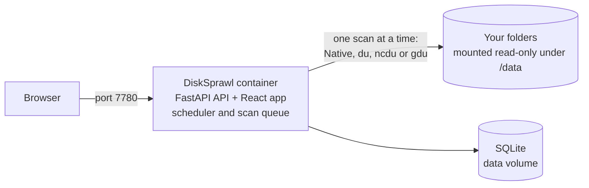

<p align="center">
  
</p>

<h1 align="center">DiskSprawl</h1>

<p align="center">
  <b>The self-hosted disk usage analyzer for your NAS and folders: scheduled scans gentle enough to leave your storage alone, a treemap of what takes up the space, its history and what changed between scans.</b>
</p>

<p align="center">
  <a href="https://github.com/DrDonoso/disksprawl/actions/workflows/docker-deploy.yml"></a>
  <a href="LICENSE"></a>
  <a href="https://hub.docker.com/r/drdonoso/disksprawl"></a>
  <a href="https://hub.docker.com/r/drdonoso/disksprawl"></a>
</p>

<p align="center">
  <a href="https://demo.disksprawl.drdonoso.com"><b>Try the live demo →</b> demo.disksprawl.drdonoso.com</a><br>
  <sub>It runs entirely in your browser with synthetic data: a fictional home server with four directories and a year of scans.
  You can change any setting and run scans. Nothing is saved: a reload starts over.</sub>
</p>

<p align="center">
  
</p>

<p align="center">
  <sub><b>A directory</b>: when it was last updated, its volume, size and schedule, and a treemap of its folders.<br>
  <b>All the data in this and every other screenshot is synthetic, taken from the demo: no real server, folder or file is shown.</b></sub>
</p>

---

## Contents

- [Why DiskSprawl](#why-disksprawl)
- [Features](#features)
- [Screenshots](#screenshots)
- [How it works](#how-it-works)
- [Deploy with Docker](#deploy-with-docker)
- [Updating and backups](#updating-and-backups)
- [Configuration](#configuration)
- [Scan engines](#scan-engines)
- [Development](#development)
- [Contributing](#contributing)
- [Security](#security)
- [License](#license)
- [Credits](#credits)

## Why DiskSprawl

A NAS fills up slowly and then all at once, and the question is always the same: what grew, and
since when? Desktop disk analyzers answer it once, by walking every folder as fast as they can,
which over a network share can keep the NAS busy for an hour and slow everything else down.

DiskSprawl runs next to your storage instead. Each directory you add is scanned on its own
schedule, with the method and the pace you choose, from a light single thread with pauses to a
fast parallel walk. It keeps the results, so you can see how a directory and its volume evolve
and exactly which folders grew or shrank between two scans. It only ever reads your folders.

## Features

**Scanning without saturating your storage**

- **Four scan engines**, each explained by a tooltip in the settings: the built-in **Native**
  engine (Python, multi-threaded, with live progress), **du** from GNU coreutils, **ncdu** 2 and
  **gdu**. All of them give the same totals: CI checks it on the same tree.
- **Threads**, **pace** (*Maximum*, *Balanced* rests a quarter of the time, *Gentle* half of it)
  and **low priority** (`nice` and `ionice`) for every directory. du, ncdu and gdu are paused by
  freezing the process at intervals, so even they can go gently.
- **A schedule per directory**: presets or any cron expression, checked as you type, with its next
  runs. One queue for all directories, so two scans never compete for the same disks; a scheduled
  scan missed by less than an hour, during a restart for example, still runs.
- **Live progress** of the running scan: folders, files and bytes read, the folder being read, and
  an estimated percentage and time left from the previous scan. Scans can be cancelled.
- Apparent size or space on disk, hard links counted once, symbolic links not followed, an option
  to stay on one file system (`du -x`) and exclusion patterns. Snapshot folders (`.snapshot`,
  `#snapshot`, `.zfs`) are excluded by default so nothing is counted twice; recycle bins count.

**Seeing where the space goes**

- **"Updated 3 hours ago"** on every directory, and a clear notice when the last scan failed, with
  the data of the last successful one still shown.
- A navigable **treemap** with breadcrumbs and a table of each level. Its **Changes** view
  compares two scans: tiles are as big as the folder was at its largest, red when it grew, green
  when it freed space and grey when nothing changed, with the biggest changes listed.
- **Volume capacity** of every folder (like `df`), measured every 15 minutes without walking any
  folder, with warning and critical thresholds. Directories on the same volume are recognized.
- **History** charts of each directory's size and of its volume's use over 30, 90 or 365 days,
  and the latest scans with their engine, duration and errors.

**Self-hosted and read-only**

- One Docker image for amd64 and arm64, with SQLite: no other service to run.
- Read-only by design: folders mounted read-only, a read-only container without Linux
  capabilities, running as an unprivileged user.
- An optional single password, signed HttpOnly cookies, throttled sign-in, cross-site request
  forgery and DNS rebinding protection, and a strict Content Security Policy. See the
  [security model](docs/security-model.md).
- English and Spanish, and light and dark themes that follow your browser and system.

## Screenshots

| Changes between scans | History |
| :--: | :--: |
|  |  |
| What grew (red) and what freed space (green) since any earlier scan. | Size and volume use over time, and every scan with its result. |

| Scan settings, with their explanations | Adding a directory |
| :--: | :--: |
|  |  |
| Schedule, engine, threads, pace and more for each directory; every option has a tooltip. | A folder picker browses the folders mounted under `/data`. |

| A scan in progress | The directories menu |
| :--: | :--: |
|  |  |
| Live counters and an estimate based on the previous scan. | Volume use, last update, progress and problems at a glance; the menu can be hidden. |

<p align="center">
  <br>
  <sub>The same interface on a phone, where the menu opens over the page.</sub>
</p>

> **Every screenshot shows synthetic data from the [demo](https://demo.disksprawl.drdonoso.com).**

## How it works



- The container serves the web interface and its API, schedules the scans and runs them one at a
  time. Each scan is a separate low-priority process, so it can be paused, cancelled and kept
  from slowing down the interface, whatever the engine.
- The engine's output is reduced to the folders worth keeping (1 MiB or more by default) and
  stored in SQLite with the totals, so the treemap, the changes and the history are queries, not
  new scans.
- **Backend**: Python 3.14, FastAPI, SQLAlchemy 2 and Alembic, SQLite, APScheduler and ijson.
- **Frontend**: React 19, TypeScript, Vite, TanStack Query and React Aria Components; the treemap
  is drawn with the squarified algorithm, without chart libraries.
- **Engines**: GNU du from the Debian base image, and the official static builds of ncdu 2.9.1 and
  gdu 5.39.0, pinned by version and checksum.

## Deploy with Docker

You need a Linux machine with Docker Engine and the Compose plugin, amd64 or arm64, where the
folders to analyze are reachable: local disks, or network shares mounted on the host. To run it in
a Proxmox LXC container next to a NAS, follow the
[NAS and Proxmox guide](docs/deployment.md#proxmox-lxc-and-a-nas).

1. **Download the Compose file and the settings** into a new folder:

   ```bash
   mkdir disksprawl && cd disksprawl
   curl -fsSLO https://raw.githubusercontent.com/DrDonoso/disksprawl/main/docker-compose.yml
   curl -fsSL -o .env https://raw.githubusercontent.com/DrDonoso/disksprawl/main/.env.example
   ```

2. **Mount the folders to analyze** read-only under `/data`, one line each, in the `volumes` of
   `docker-compose.yml`:

   ```yaml
       volumes:
         - data:/app/data
         - /mnt/storage:/data/storage:ro
         - /srv/media:/data/media:ro
   ```

   The container runs as user 1000, which must be able to list them; see
   [permissions](docs/deployment.md#permissions). Optionally, set `TZ` (the time zone of the
   schedules) and `AUTH_PASSWORD` (a password of at least 12 characters) in `.env`.

3. **Start it** and wait until it is `healthy`:

   ```bash
   docker compose up -d
   docker compose ps
   ```

4. **First steps**: open `http://<host>:7780`, press **⚙** at the top right, then
   **Add directory**. Pick a folder such as `/data/storage`, choose its schedule and scan method
   (the defaults are a gentle daily scan at 03:00) and press **Add directory**. Then press
   **Scan now** to see it right away.

To try it from the source code with a synthetic sample tree instead, see
[`docker-compose.local.yml`](docker-compose.local.yml). The [deployment guide](docs/deployment.md)
covers reverse proxies and HTTPS, network shares, permissions and troubleshooting.

## Updating and backups

```bash
docker compose pull
docker compose up -d
```

Releases are published as `latest` and as a CalVer tag such as `20261115` (see the
[releases](https://github.com/DrDonoso/disksprawl/releases)). To update only when you decide, set
`IMAGE_TAG` in `.env` to a release. Database migrations run on start.

Everything DiskSprawl stores is in the `data` volume: the database with the scan history, and the
session key. To back it up, copy the volume while the app is stopped:

```bash
docker compose stop
docker run --rm -v disksprawl_data:/data:ro -v "$PWD":/backup alpine tar -czf /backup/disksprawl-data.tar.gz -C /data .
docker compose start
```

Your folders are never written, so they are not part of the backup. See
[backup and restore](docs/deployment.md#backup-and-restore).

## Configuration

Set these in `.env`; all of them are optional. [docs/configuration.md](docs/configuration.md)
describes each one.

| Variable | Default | Purpose |
| --- | --- | --- |
| `IMAGE_TAG` | `latest` | Image tag to run, such as a CalVer release. |
| `APP_BIND_ADDRESS` | `0.0.0.0` | Host address the port is published on; `127.0.0.1` behind a local reverse proxy. |
| `APP_PORT` | `7780` | Host port. |
| `TZ` | `Etc/UTC` | Time zone of the schedules, such as `Europe/Madrid`. |
| `AUTH_PASSWORD` | empty | Single password (at least 12 characters); empty leaves the interface open. |
| `AUTH_SECRET` | generated | Key that signs session cookies (at least 32 characters). |
| `AUTH_COOKIE_SECURE` | `false` | `true` when served over HTTPS. |
| `SESSION_HOURS` | `168` | How long a sign-in lasts. |
| `ALLOWED_HOSTS` | empty | Extra host names, such as a reverse proxy's domain; IP addresses and local names always work. |
| `TRUSTED_PROXY_IPS` | `127.0.0.1` | Reverse proxies whose forwarded headers are trusted. |

The schedules and scan methods of each directory, the capacity measurement interval, how many
scans keep their folders (30 per directory), the smallest folder stored (1 MiB), the volume
thresholds (80 % and 90 %) and the language are set in the interface, under **⚙ Settings**.

## Scan engines

Every directory picks its engine; [docs/engines.md](docs/engines.md) explains how each one is
run, paced and measured.

| Engine | What it runs | Threads | Progress while scanning | Counts files | Good for |
| --- | --- | --- | --- | --- | --- |
| **Native** | The built-in engine (Python `os.scandir`) | 1–16 | Live: folders, files, bytes and the folder being read | Yes | Any storage; the easiest to throttle. |
| **du** | `du -0 -b` from GNU coreutils | 1 | Finished folders | No | A steady, light load with little CPU and memory. |
| **ncdu** | `ncdu -0 -o-` (2.9.1) | 1–16 | Live; approximate with several threads | Yes | As light as du with 1 thread; faster with more. |
| **gdu** | `gdu -n -p -o-` (5.39.0) | 1–8 | Only when it finishes | Yes | SSDs and NFS, where reading in parallel pays off. |

All engines share the pace, low priority, measure, file system and exclusion settings. For a NAS
over SMB, start with 1 to 4 threads and the *Balanced* or *Gentle* pace.

## Development

The backend uses [uv](https://docs.astral.sh/uv/) and the frontend npm. In short:

```bash
uv sync
python3 scripts/make_sample_tree.py sample
DATA_DIR=data SCAN_ROOT="$PWD/sample" uv run uvicorn --factory disksprawl.app:app --port 7780 --reload
cd frontend && npm ci && npm run dev   # http://127.0.0.1:5173
```

[docs/development.md](docs/development.md) covers the checks, tests, the API contract, migrations,
translations, the demo and releases.

## Contributing

Contributions are welcome! Read [CONTRIBUTING.md](CONTRIBUTING.md) and the
[code of conduct](CODE_OF_CONDUCT.md), and open an issue first for larger changes.

## Security

Report vulnerabilities privately, as described in [SECURITY.md](SECURITY.md), never in a public
issue. The [security model](docs/security-model.md) explains how DiskSprawl is protected and how to
harden a deployment.

## License

[MIT](LICENSE) © 2026 DrDonoso.

## Credits

The image includes, unmodified and under their own licenses:

- [ncdu](https://dev.yorhel.nl/ncdu) by Yorhel, MIT license.
- [gdu](https://github.com/dundee/gdu) by Daniel Milde, MIT license.
- du from [GNU coreutils](https://www.gnu.org/software/coreutils/), GPL 3.0 or later, as packaged
  by Debian.

Their notices are in [`licenses/`](licenses/), also copied into the image as `/app/licenses`. The
treemap follows the squarified layout of Bruls, Huizing and van Wijk (2000), and the demo answers
its API with [Mock Service Worker](https://mswjs.io).
